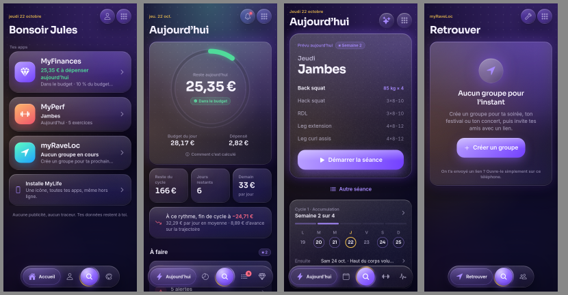

# MyLife

**Ton environnement numérique personnel.** Tes finances, ton entraînement et tes sorties dans une seule app : un compte,
une installation, et des données chiffrées sur ton téléphone avant de le quitter.

> **MyLife est en refonte (V5).** On garde peu de choses et on les rend excellentes : MyFinances, MyPerf, MyRave et
> Copilot. La direction et le plan sont dans [`docs/VISION.md`](docs/VISION.md), l'avancement dans
> [`docs/V5.md`](docs/V5.md).



| App | Pour quoi faire |
|---|---|
| **MyFinances** (`/finances/`) | Le budget au jour près : ce qui reste à dépenser aujourd'hui, le cycle de paie, les opérations (banques en lecture seule), le patrimoine, un assistant IA. |
| **MyPerf** (`/perf/`) | La musculation : séance du jour, planning en cycles, saisie des séries, 1RM et progression, coach IA, import de programme. |
| **MyRave** (`/raveloc/`) | Retrouver ses amis en festival : groupes temporaires, partage de position limité dans le temps, une flèche et une distance. Bientôt aussi les Sorties (organiser une soirée à plusieurs). |
| **Copilot** | Une IA pour toutes tes apps, avec ta propre clé : elle lit tes résumés, propose, et n'agit qu'après ta validation. |

---

## Utiliser MyLife

1. Ouvre **https://mylife-liart.vercel.app** sur ton téléphone.
2. Touche **Commencer**, choisis un identifiant et un mot de passe. Pas de courriel, pas de code.
3. Mets de côté ta **clé de secours** : elle seule permet de retrouver tes données si tu oublies ton mot de passe.
   Personne d'autre ne peut les lire, pas même le serveur.

**Installer** : Android ou ordinateur (Chrome, Edge) → Accueil → *Installe MyLife* ; iPhone (Safari) → Partager →
*Sur l'écran d'accueil*.

**Plusieurs appareils** : connecte-toi avec le même identifiant, tout se synchronise, chiffré. Sur un appareil partagé,
un compte ne voit jamais rien d'un autre.

**Ton compte** (Accueil → Compte) : mot de passe, nouvelle clé de secours, export de tes données, suppression du compte,
message à l'équipe, page Confidentialité.

---

## Confidentialité

- **Chiffrement de bout en bout** : le mot de passe ne quitte jamais l'appareil ; chaque donnée est chiffrée
  (AES-256-GCM) avant l'envoi ; le serveur ne range que des blocs illisibles.
- **Aucune publicité, aucun traceur, aucune analytique.**
- Banques : Enable Banking (DSP2), lecture seule, via un relais sans état.
- Clé d'API Anthropic : sur l'appareil seulement, jamais synchronisée.
- Détail complet : page **Confidentialité** de l'app (`/confidentialite`).

---

## Développement

Node 20, Chrome (pour les tests de bout en bout).

```bash
npm run setup        # dépendances de l'accueil et des trois apps
npm run build:all    # copie des paquets partagés, puis construction de tout
npm run local        # tout MyLife sur http://localhost:4300 (vraies API, base en mémoire)
npm run test:all     # tous les tests unitaires
npm run e2e:all      # tous les parcours de bout en bout
npm run deploy:all   # déployer (les apps d'abord, puis MyLife)
```

Toutes les commandes, l'architecture actuelle, les variables d'environnement et les règles : **[`CONTEXTE.md`](CONTEXTE.md)**.

### La documentation
| Document | Contenu |
|---|---|
| [`docs/VISION.md`](docs/VISION.md) | Ce que MyLife devient, les principes, l'architecture cible, le plan. **La référence.** |
| [`docs/V5.md`](docs/V5.md) | Le journal de la V5 : chaque étape, pourquoi, comment, comment tester. |
| [`CONTEXTE.md`](CONTEXTE.md) | L'état technique actuel : architecture, commandes, comptes et synchro, règles. |
| [`docs/ARCHITECTURE.md`](docs/ARCHITECTURE.md) | La documentation technique détaillée de l'architecture actuelle (diagrammes, chiffrement, synchro). |
| [`docs/CONTRAT-APP.md`](docs/CONTRAT-APP.md) | Le contrat d'app actuel (remplacé en phase 2). |
| `apps/*/README.md` | Le détail de chaque app. |
| [`docs/archives/`](docs/archives/README.md) | L'historique d'avant la V5 (V3, V4, refonte MyFinances, unification…). |
