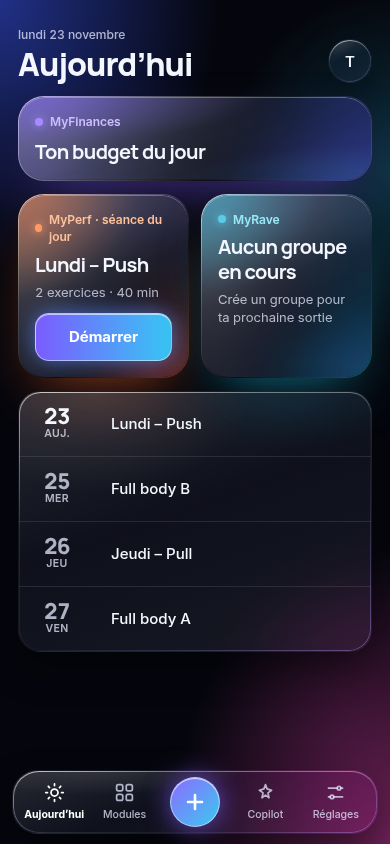
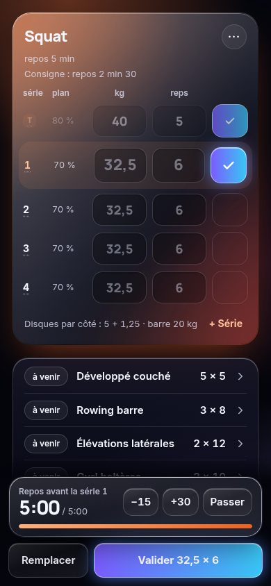
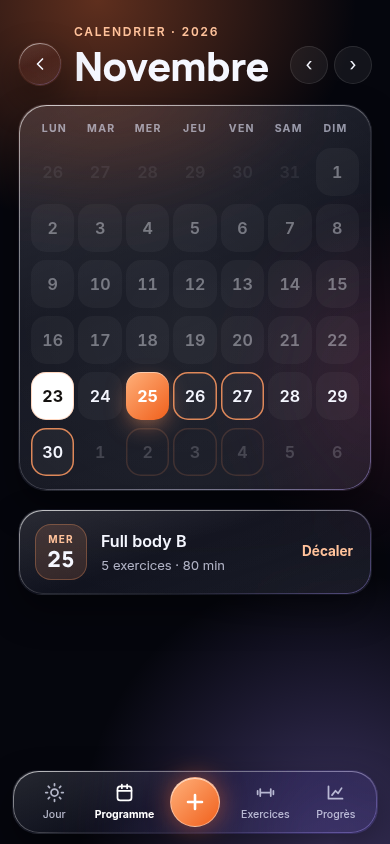
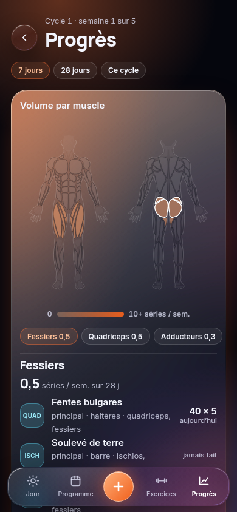

# MyLife

**Ton environnement numérique personnel.** Tes finances, ton entraînement et tes sorties dans une seule app : un compte,
une installation, et des données chiffrées sur ton téléphone avant de le quitter.

> **MyLife est en refonte (V5) : moins de choses, mais excellentes.** MyFinances est refait (phase 3, à l'essai en
> usage réel), **MyPerf est refait** (phase 4 : toutes les pages, à l'essai avant la bascule), MyRave et les Sorties
> suivent (phase 5). La direction est dans [`docs/VISION.md`](docs/VISION.md), l'avancement dans
> [`docs/V5.md`](docs/V5.md).

<table>
  <tr>
    <td></td>
    <td></td>
    <td></td>
    <td></td>
  </tr>
</table>

<sub>Captures prises par les parcours de test automatiques, sur un compte de test.</sub>

| Module | Adresse | Pour quoi faire |
|---|---|---|
| **MyFinances** | `/argent` | Le budget au jour près : ce qui reste à dépenser aujourd'hui, le cycle de paie, les opérations (banques en lecture seule), le plan, le patrimoine et les placements. |
| **MyPerf** | `/sport` | La musculation : séance du jour, séance en direct (repos, clavier, ordinateur), programme en blocs ou en routine, cycles complets (macrocycles, blocs, semaines en groupes de séries libres, exceptions par exercice), exercices et 1RM, progrès, bilans, calendrier, notification de fin de repos, import (texte, PDF ou photo convertis par Claude) et export complet réimportable. L'app d'avant reste à `/perf/` jusqu'à la bascule. |
| **MyRave** | `/raveloc/` | Retrouver ses amis en festival : groupes temporaires, partage de position limité dans le temps, une flèche et une distance. Bientôt aussi les Sorties. |
| **Copilot** | `/copilot` | Une IA pour tous tes modules, avec ta propre clé (Opus 5.5 ou Sonnet 5.5, au choix) : elle lit tes résumés, propose (décaler une séance, sauter un prélèvement), et n'agit qu'après ta validation. |

---

## Utiliser MyLife

1. Ouvre **https://mylife-liart.vercel.app** sur ton téléphone.
2. Touche **Commencer**, choisis un identifiant et un mot de passe. Pas de courriel, pas de code.
3. Mets de côté ta **clé de secours** : elle seule permet de retrouver tes données si tu oublies ton mot de passe.
   Personne d'autre ne peut les lire, pas même le serveur.

**Installer** : Android ou ordinateur (Chrome, Edge) → Réglages → *Installer MyLife* ; iPhone (Safari) → Partager →
*Sur l'écran d'accueil* (les notifications de fin de repos demandent l'app installée sur iPhone).

**Plusieurs appareils** : connecte-toi avec le même identifiant, tout se synchronise, chiffré. Sur un appareil partagé,
un compte ne voit jamais rien d'un autre.

**Tes données** : chaque module exporte les siennes (MyFinances : Réglages → Tes données ; MyPerf : Tes données →
*Tout exporter*, un fichier JSON lisible que tu peux retoucher et réimporter sans doublon). Compte (Réglages) : mot de
passe, nouvelle clé de secours, suppression du compte, message à l'équipe, page Confidentialité.

---

## Confidentialité

- **Chiffrement de bout en bout** : le mot de passe ne quitte jamais l'appareil ; chaque donnée est chiffrée
  (AES-256-GCM) avant l'envoi ; le serveur ne range que des blocs illisibles.
- **Aucune publicité, aucun traceur, aucune analytique.**
- Banques : Enable Banking (DSP2), lecture seule, via un relais sans état.
- Clé d'API Anthropic : sur l'appareil seulement, jamais synchronisée ; les appels partent du navigateur vers
  Anthropic, et nulle part ailleurs.
- Notification de fin de repos : le serveur ne reçoit qu'une heure de fin, effacée une fois la notification partie.
- Détail complet : page **Confidentialité** de l'app (`/confidentialite`).

---

## Développement

Node 20, Chrome (pour les tests de bout en bout).

```bash
npm run setup        # dépendances de la coquille, de l'accueil d'avant et des trois apps
npm run build:all    # copie des paquets partagés, puis construction de tout
npm run local        # tout MyLife sur http://localhost:4300 (vraies API, base en mémoire)
npm run typecheck:all && npm run lint:all
npm run test:all     # tous les tests unitaires
npm run e2e:all      # tous les parcours de bout en bout
npm run deploy:all   # déployer (les apps d'abord, puis MyLife)
```

Toutes les commandes, l'architecture actuelle, les variables d'environnement et les règles : **[`CONTEXTE.md`](CONTEXTE.md)**.

### Le dépôt en bref

| Dossier | Contenu |
|---|---|
| `app/` | **La coquille V5** (React + Vite), servie à `/` : accueil, Copilot, réglages, et les modules (`app/src/modules/` : MyFinances, MyPerf). |
| `packages/kit` | Le kit d'interface de la coquille (verre, navigation, composants). |
| `packages/training` | Le métier de MyPerf, pur et testé : prescription, 1RM, cycles, groupes de séries, moteur composable, format d'échange des programmes. |
| `packages/sync-client`, `packages/lumen` | Compte, chiffrement et synchro ; jetons, aperçus, agenda commun, actions validées. |
| `api/`, `server/` | Le serveur « zéro connaissance » (comptes, synchro chiffrée, MyRave, notifications, support). |
| `web/` | L'accueil d'avant la V5 (`/ancien/`, encore là pour les Sorties). |
| `apps/` | Les apps d'avant : `perf` (jusqu'à la bascule), `raveloc` (MyRave), `finances` (retirée, garde le relais bancaire). |

### La documentation

| Document | Contenu |
|---|---|
| [`docs/VISION.md`](docs/VISION.md) | Ce que MyLife devient, les principes, l'architecture cible, le plan. **La référence.** |
| [`docs/V5.md`](docs/V5.md) | Le journal de la V5 : où on en est (en tête), puis chaque étape, pourquoi, comment, comment tester. |
| [`CONTEXTE.md`](CONTEXTE.md) | L'état technique actuel : architecture, commandes, comptes et synchro, règles. |
| [`docs/ARCHITECTURE.md`](docs/ARCHITECTURE.md) | La documentation technique détaillée (diagrammes, chiffrement, synchro, moteur de MyPerf). |
| [`docs/V5-MYPERF-TRAINING.md`](docs/V5-MYPERF-TRAINING.md) | L'architecture du moteur de MyPerf (`packages/training`), les groupes de séries, le format d'échange. |
| [`docs/CONTRAT-APP.md`](docs/CONTRAT-APP.md) | Le contrat des apps d'avant (les modules V5 suivent `app/src/contract.ts`). |
| `apps/*/README.md` | Le détail de chaque app d'avant. |
| [`docs/archives/`](docs/archives/README.md) | L'historique d'avant la V5 (V3, V4, refonte MyFinances, unification…). |
