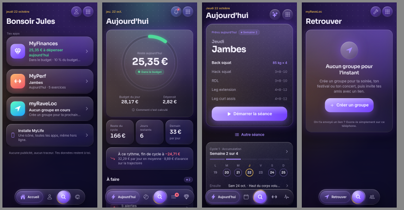
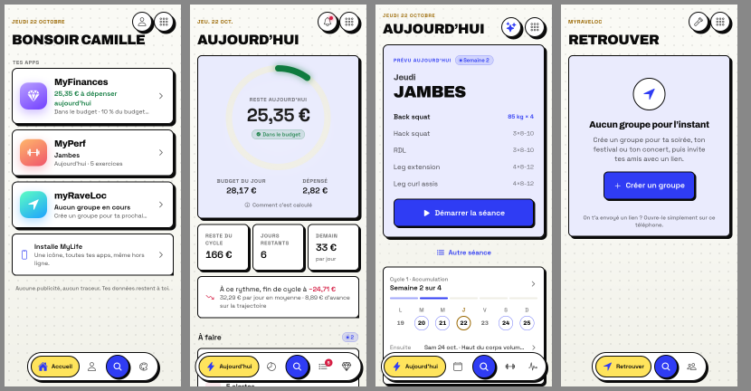
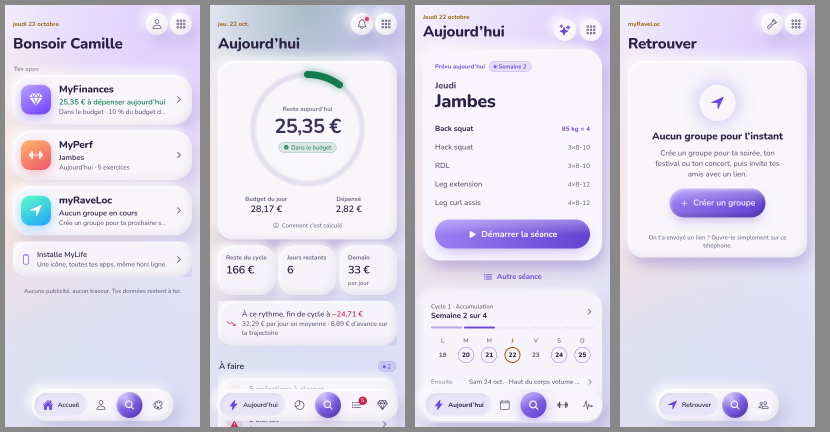
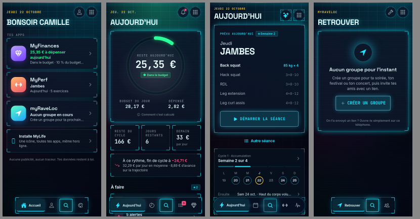

# MyLife

**Tes finances, ton entraînement et tes sorties dans une seule app.** Un compte, une installation, un
même design d'un bout à l'autre, et des données chiffrées sur ton téléphone avant de le quitter.



| | App | Pour quoi faire |
|---|---|---|
| ✦ | **Accueil MyLife** (`/`) | Ton **Personnage** (un RPG de ta vraie vie : niveaux, quêtes de la semaine, série), tes apps et ce qu'elles ont à te dire maintenant (« 25 € à dépenser aujourd'hui », « Jambes · 5 exercices »), ton compte, l'apparence, l'installation. |
| ◆ | **MyFinances** (`/finances/`) | Le budget au jour près : ce qui reste à dépenser aujourd'hui, le cycle de paie, les opérations (banques en lecture seule), le patrimoine, l'indépendance financière, un assistant IA. |
| 🏋 | **MyPerf** (`/perf/`) | La musculation : séance du jour, planning en cycles, saisie des séries, 1RM et progression, carte musculaire, coach IA, **import de ton programme** (avec l'IA gratuite de ton choix, en texte collé, ou un programme prêt). Aussi en app Android. |
| ➤ | **MyRave** (`/raveloc/`) | Retrouver ses amis en festival : groupes temporaires, partage de position limité dans le temps, une flèche et une distance, mode phare. |

---

## Utiliser MyLife

### Commencer
1. Ouvre **https://mylife-liart.vercel.app** sur ton téléphone.
2. Touche **Commencer**, choisis un identifiant et un mot de passe. C'est tout : pas de courriel, pas de code.
   Le gestionnaire de mots de passe du téléphone peut en proposer un et l'enregistrer.
3. MyLife te montre ta **clé de secours**. Mets-la de côté (copier, partager, enregistrer). Elle seule
   permet de retrouver tes données si tu oublies ton mot de passe : personne d'autre ne peut les lire, pas
   même le serveur. Tu peux aussi le faire plus tard : un rappel reste affiché jusque-là.

Le compte est **obligatoire** dans les quatre parties de MyLife : sans lui, l'app n'affiche que la création de compte. Il est gardé sur l'appareil, donc ensuite tout s'ouvre même sans réseau.

### Installer l'app
- **Android / ordinateur (Chrome, Edge)** : Accueil → **Installe MyLife** → *Installer*.
- **iPhone (Safari)** : Partager → *Sur l'écran d'accueil*.

Une seule icône pour tout : un **appui long** dessus mène directement à MyFinances, MyPerf ou MyRave.
Si tu avais installé l'une de ces apps à part, tu peux la désinstaller : MyLife la contient, avec les
mêmes données.

### Au quotidien
- **Passer d'une app à l'autre** : bouton ⠿ en haut à droite (*Espaces MyLife*), ou l'orbe 🔍 du dock.
- **Chercher partout** : l'orbe ouvre la palette ; tape « séance », « budget », « groupe »… elle propose
  aussi les écrans des autres apps.
- **Appui long sur l'orbe** : l'assistant (MyFinances), le coach (MyPerf), le mode phare (MyRave).
- **Apparence** : 12 thèmes, dont 4 identités complètes (Circuit, Ardoise, Argile, Brut). Le thème choisi
  habille toutes les apps, et suit sur tes autres appareils.

| Brut | Argile | Circuit |
|---|---|---|
|  |  |  |

### Ton personnage
Sur l'accueil, un personnage dont les stats montent toutes seules avec ce que tu fais déjà : **Force** (séances et
records dans MyPerf), **Discipline** (jours sous ton budget, épargne tenue dans MyFinances), **Social** (groupes et amis
dans MyRave, sorties), **Constance** (semaines réussies d'affilée), **Culture** (ta musique, avec MyMusique). Chaque lundi, de nouvelles quêtes calées sur ton rythme ;
une semaine de repos se déclare sans casser la série. Le dimanche, **ta semaine en bref** ; en début de mois et en
fin d'année, ton **Wrapped** en stories, avec une image à partager (créée sur ton téléphone, sans aucun montant). Seuls des nombres par semaine sont utilisés (aucun montant,
aucun détail), chiffrés dans ton compte : le même personnage sur tous tes appareils.

### Copilot
Une seule IA pour toutes tes apps : « je peux me payer ce billet ? », « résume ma semaine », « quelle semaine alléger
avant ma sortie ? ». Elle lit tes résumés (budget, séances, bilans, musique, jeux, sorties) et propose ; elle ne modifie
rien. Avec ta propre clé Anthropic, depuis ton appareil (la même clé que l'assistant de MyFinances et le coach de MyPerf).

### MyMusique
Tes stats Spotify quand tu veux : demande ton export de données à Spotify, ouvre le .zip reçu dans MyMusique. Artistes
et morceaux du mois et de l'année, ton obsession du moment, ton heure d'écoute, tes séries, tes découvertes, et la
stat Culture de ton personnage. Le fichier est lu sur ton téléphone : seul un résumé est gardé, chiffré.

### Mes apps
Crée tes propres petites apps de suivi, sans code : lecture, eau, sommeil, humeur, méditation, une habitude… Pars d'un
modèle, ou décris ce que tu veux à n'importe quelle IA gratuite (MyLife te donne la demande à copier) et colle sa
réponse : MyLife la vérifie, puis l'app est prête (saisies, objectif, série, stats, graphique). Partage une app par un
lien : il contient l'app, jamais tes saisies. Tes saisies sont chiffrées dans ton compte et Copilot peut les lire.

### MyGames et « Où va ton temps ? »
Tes heures de jeu : depuis Steam (profil public), ou notées à la main pour la console et le mobile. Et une vue
honnête de ton temps : sport, musique, jeu, côte à côte. Le jeu ne rapporte pas de points à ton personnage.

### Sorties
Un festival, un week-end, une soirée : propose, envoie le lien, chacun répond « chaud ». Puis, au même endroit et
chiffré : le planning set par set (qui va où), le budget partagé (qui doit combien à qui, au centime près), la liste à
emporter, et le carnet d'ID (un toucher en plein set : l'heure, la scène et le DJ sont notés). Ça marche hors ligne :
tout part dès que le réseau revient.

### Ton Crew
Entre amis, un classement du mois : chacun voit le niveau, le titre, la série et les XP du mois des autres (et le
niveau des stats que chacun choisit de montrer). Crée un Crew, envoie le lien : la clé du Crew voyage dans le lien,
le serveur ne peut rien lire. Quitter efface ton score. Et des **pactes** : « 3 séances par semaine chacun, 4 semaines,
5 € par semaine ratée », validés tout seuls par tes apps ; la cagnotte (virtuelle) paie la soirée.

### Plusieurs appareils
Connecte-toi avec le même identifiant : tes données, chiffrées, se synchronisent toutes seules (à
l'ouverture, quelques secondes après chaque changement, au retour sur l'app). Un appareil neuf récupère
tout sans question ; MyLife ne demande que dans le cas rare où l'appareil a des données saisies hors de
tout compte (un compte neuf propose alors de partir de zéro ; une copie est gardée avant d'effacer).

**Un appareil partagé** (un même navigateur, plusieurs comptes) : un compte ne voit jamais rien d'un autre.
Quand quelqu'un d'autre se connecte, l'appareil efface les données, la clé d'API et les aperçus du compte
précédent (qui les retrouve en se reconnectant : elles sont dans son compte).

### Compte
Accueil → **Compte** : changer de mot de passe, nouvelle clé de secours, se déconnecter (de toutes les
apps de l'appareil), **supprimer le compte** (tout ce qu'il sauvegarde est effacé du serveur ; les appareils
gardent leurs données). Aussi : **Mes données** (export lisible de l'accueil et chemin vers l'export de chaque
app), **Un problème, une idée ?** (message à l'équipe, non chiffré et c'est dit) et la page **Confidentialité**
(`/confidentialite`, lisible sans compte). Sur **Ta semaine** : le **rappel du dimanche** (notification
facultative, même texte pour tous, sans aucune donnée).

---

## Confidentialité

- **Chiffrement de bout en bout.** Le mot de passe ne quitte jamais l'appareil (PBKDF2-SHA256, 200 000
  tours, puis HKDF). Chaque donnée est chiffrée en AES-256-GCM avant l'envoi ; le serveur ne range que des
  blocs illisibles, et ne connaît ni le mot de passe ni le contenu.
- **MyRave** : noms de groupe, pseudos et positions chiffrés avec une clé de groupe transmise dans le lien
  d'invitation (jamais au serveur). Partage coupé par défaut, limité dans le temps, effacé à l'arrêt.
- **Aucune publicité, aucun traceur, aucune analytique.** Les aperçus de l'accueil restent sur l'appareil.
- Banques : Enable Banking (DSP2), lecture seule, via un relais sans état.
- Clé d'API Anthropic (assistant, coach, Copilot) : sur l'appareil seulement ; effacée si un autre compte se connecte.
- Messages au support : lisibles par l'équipe (non chiffrés), 90 jours au plus, effacés avec le compte.
- Détail complet : page **Confidentialité** de l'app (`/confidentialite`).

---

## Développement

### Organisation

```
MyLife/
├── web/                 Accueil MyLife (React + Vite) — la seule PWA installable (manifeste, portée /)
├── api/, server/        API Vercel : comptes (/api/auth), synchro chiffrée (/api/sync), MyRave (/api/raveloc), espaces partagés (/api/space), relais Steam (/api/games), support (/api/support), notifications (/api/push, /api/cron-weekly)
├── packages/
│   ├── lumen/           Thèmes, identités, registre des apps et de leurs écrans, aperçus, apparence commune
│   ├── sync-client/     Compte et synchro chiffrée (TypeScript pur : web et React Native)
│   └── ui/              Kit d'interface web : verre, identités, dock, écrans, feuilles, compte, palette, Espaces
├── apps/
│   ├── finances/        MyFinances — React 18 + Vite + Tailwind + Dexie
│   ├── perf/            MyPerf — Expo / React Native (web + Android) + SQLite
│   └── raveloc/         MyRave — React 18 + Vite
├── tests/               Serveur (Postgres en mémoire) et parcours de bout en bout de tout MyLife
└── docs/                UNIFICATION.md (choix notés), images
```

**Une adresse, plusieurs déploiements.** Chaque app est un projet Vercel à part ; MyLife (accueil + API)
les sert sous la même adresse par des réécritures (`vercel.json`). Même adresse = même stockage : une
seule connexion, un seul thème, une seule app installée.

**Code partagé.** Les paquets de `packages/` sont **recopiés** dans chaque app par `npm run vendor`
(`src/vendor/lumen`, `src/vendor/mylife-sync`, et `src/ui` pour les apps web). On modifie toujours dans
`packages/`, jamais dans les copies. MyPerf (React Native) n'utilise pas le kit web : il en reproduit
l'apparence avec ses propres composants, à partir des mêmes jetons (`lumen`).

### Démarrer

Node 20, Chrome (pour les tests de bout en bout).

```bash
npm run setup        # dépendances de l'accueil et des trois apps
npm run build:all    # copie des paquets, puis construction de l'accueil et des trois apps
npm run local        # tout MyLife sur http://localhost:4300 (vraies API, base en mémoire)
```

### Commandes

| Action | Commande |
|---|---|
| Copier les paquets partagés dans les apps | `npm run vendor` |
| Tous les tests unitaires | `npm run test:all` (serveur 122, MyFinances 337, MyRave 83, MyPerf 235) |
| Parcours de bout en bout de tout MyLife | `npm run e2e` (accueil, compte, les trois apps, thème, second appareil, autre compte sur le même navigateur, 320 px) |
| Tous les parcours de bout en bout | `npm run e2e:all` |
| Développer l'accueil | `npm run dev` (+ `npm run local` pour les API) |
| Développer une app | dans `apps/<app>` : `npm run dev` (MyPerf : `npx expo start --web --port 8090`) |
| Déployer tout | `npm run deploy:all` (les apps d'abord, puis MyLife) |
| Volumes du serveur (comptes, lignes, taille ; aucun contenu) | `DATABASE_URL=… npm run stats:serveur` |
| Lire les messages au support, puis les effacer une fois traités | `DATABASE_URL=… npm run support` (puis `-- done <id>`) |
| APK MyPerf | `cd apps/perf/android && ANDROID_HOME=~/android-sdk ./gradlew assembleRelease -PreactNativeArchitectures=arm64-v8a --max-workers=2` |

### Variables d'environnement (projet Vercel `mylife`)

| Variable | Rôle |
|---|---|
| `DATABASE_URL` | Postgres (Neon) |
| `SESSION_SECRET` | Signe les sessions (aussi sur `myfinances` pour le relais bancaire) |
| `SIGNUP` | `open` (défaut : inscription libre, protégée) ou `invite` (code exigé) |
| `INVITE_CODE` | Code d'invitation, seulement en mode `invite` |
| `STEAM_API_KEY` | Facultatif : clé de l'API Steam pour MyGames (sans elle, saisie à la main) |
| `VAPID_PUBLIC_KEY`, `VAPID_PRIVATE_KEY` | Facultatif : clés des notifications (`npx web-push generate-vapid-keys`) ; sans elles, le rappel du dimanche est masqué |
| `VAPID_SUBJECT` | Facultatif : adresse de contact des notifications (`mailto:…` ou l'adresse du site) |
| `CRON_SECRET` | Protège `/api/cron-weekly` (appelé par le cron de Vercel le dimanche à 17 h UTC) |

Garde-fous de l'inscription ouverte : 10 comptes par réseau et par jour (sur une empreinte de l'adresse),
10 essais de mot de passe ou de clé de secours par quart d'heure et par identifiant, quotas de stockage
par app.

### Pour aller plus loin
- `docs/ROADMAP.md` : la feuille de route, étape par étape ; `docs/V3.md` : le journal de la V3 (où on en est, pourquoi, comment).
- `docs/ARCHITECTURE.md` : documentation technique complète (pattern, flux, séquence, automates, modèle de données, algorithmes, avec diagrammes Mermaid).
- `CONTEXTE.md` : la référence complète (architecture, décisions, règles, état).
- `docs/UNIFICATION.md` : les idées de l'unification, notées avant et après réalisation, avec les sources.
- `apps/*/README.md` : le détail de chaque app.
