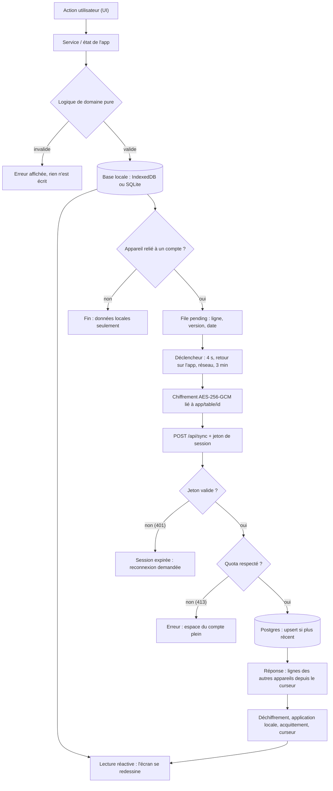
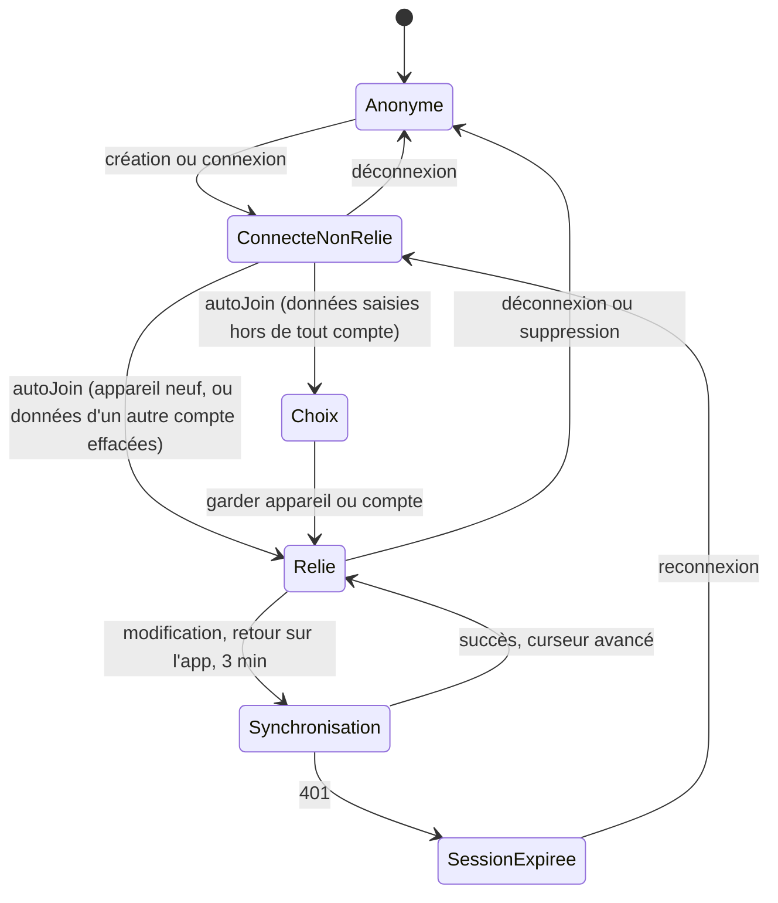
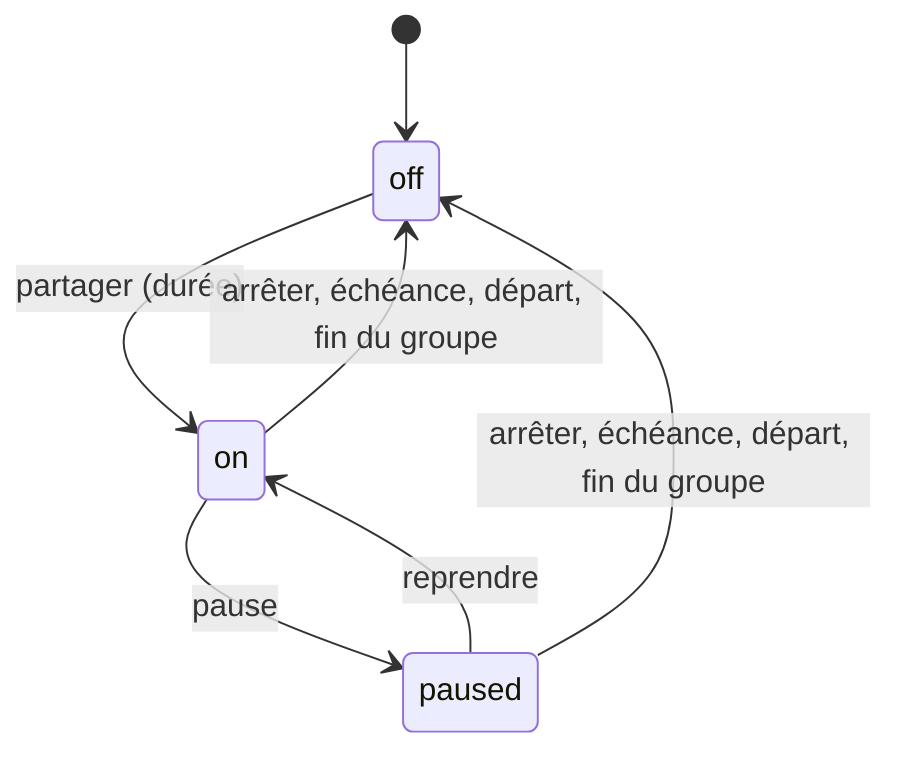
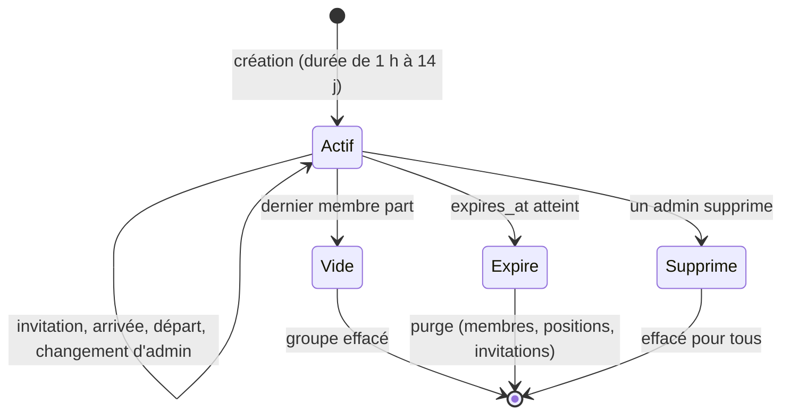

# MyLife — Documentation technique et architecturale

> Version du 22/10/2026. Périmètre : l'écosystème MyLife dans son ensemble — l'accueil (`web/`), le serveur
> (`api/`, `server/`), les paquets partagés (`packages/`) et les trois applications (`apps/finances`,
> `apps/perf`, `apps/raveloc`). Les diagrammes sont en Mermaid.js (rendus par GitHub et la plupart des
> éditeurs Markdown).

## Sommaire

1. [Architecture et pattern structurel](#1-architecture-et-pattern-structurel)
2. [Flux de contrôle macro](#2-flux-de-contrôle-macro)
3. [Diagramme de séquence fonctionnel](#3-diagramme-de-séquence-fonctionnel)
4. [Machines d'états et automates](#4-machines-détats-et-automates)
5. [Modèle conceptuel des données](#5-modèle-conceptuel-des-données)
6. [Analyse algorithmique et logique maîtresse](#6-analyse-algorithmique-et-logique-maîtresse)

---

## 1. Architecture et pattern structurel

### 1.1 Pattern global

MyLife n'est pas une application monolithique mais un **système de clients épais (« local-first »)
adossé à un serveur « zéro connaissance »**. Quatre patterns se superposent :

| Niveau | Pattern | Où on le voit |
|---|---|---|
| Système | **Local-first + serveur de blocs chiffrés** (end-to-end encryption) | Chaque appareil possède la vérité de ses données (IndexedDB/SQLite) ; le serveur ne stocke que des enregistrements chiffrés qu'il ne sait pas lire. |
| Déploiement | **Micro-frontends sur une origine unique** (*multi-zones* par réécritures Vercel) | `/`, `/finances/`, `/perf/`, `/raveloc/` sont quatre déploiements indépendants servis sous la même origine (`vercel.json`) : stockage, session et manifeste de PWA partagés. |
| Code | **Architecture en couches** (domaine pur → données → services → interface) dans chaque app, avec un **noyau partagé « vendorisé »** | `domain/` (logique pure et testée) ← `db/` ← `sync/` ← `ui/`. Le noyau partagé (`packages/`) est copié dans chaque app par `npm run vendor` (pas de paquet publié). |
| Serveur | **Hexagonal minimal** (ports et adaptateurs) | `server/core.ts` ne dépend que d'une interface `Db { query() }` : `pg.Pool` en production, PGlite (Postgres en mémoire) en test et en local. Les handlers `api/*.ts` ne sont que des adaptateurs HTTP. |

Le pattern d'interface est un **design system à jetons** : une seule source (`packages/lumen`) définit
thèmes, identités visuelles et registre des apps ; chaque plateforme (CSS pour le web, React Native pour
MyPerf) le traduit avec ses moyens.

### 1.2 Cartographie des modules

```text
MyLife/
├── web/                       Accueil (React 18 + Vite) — SEULE PWA installable (manifeste, portée "/")
│   └── src/pages/             Home (apps + aperçus), Account, Appearance, Install, Welcome
├── api/                       Adaptateurs HTTP Vercel (Fluid compute) : auth.ts, sync.ts, raveloc.ts
├── server/                    Cœur métier serveur, indépendant de la plate-forme
│   ├── core.ts                Comptes, sessions signées, garde-fous, synchronisation chiffrée
│   ├── auth.ts, sync.ts       Dispatchers d'actions (port d'entrée testable)
│   ├── raveloc.ts             Groupes, invitations, positions chiffrées, anti-abus
│   ├── http.ts                Pool Postgres, environnement, gestion d'erreurs, IP client
│   └── local.ts               Serveur tout-en-un pour le développement et les tests e2e
├── packages/                  Noyau partagé (source unique, copié dans les apps)
│   ├── lumen/                 Jetons : thèmes, identités, registre MYLIFE_APPS/DESTINATIONS, aperçus, apparence
│   ├── sync-client/           Cryptographie, compte, moteur de synchronisation, session web (TypeScript pur)
│   └── ui/                    Kit d'interface web : verre, dock, écrans, compte, palette, Espaces, thème
├── apps/
│   ├── finances/              MyFinances — React 18 + Dexie (IndexedDB) + Tailwind
│   │   └── src/{domain,db,sync,pages,components,assistant}
│   ├── perf/                  MyPerf — Expo / React Native (web + Android) + SQLite
│   │   └── src/{domain,db,services,state,features,ui,app}
│   └── raveloc/               MyRave — React 18 + Vite
│       └── src/{domain,lib,services,state,screens,components}
├── tests/                     Tests serveur et paquets (vitest) + parcours e2e de tout l'écosystème
└── docs/                      Ce document, UNIFICATION.md (décisions notées)
```

Responsabilités détaillées :

| Module | Responsabilité | Dépendances autorisées |
|---|---|---|
| `server/core.ts` | Invariants de sécurité : sessions HMAC, empreintes d'authentification, limitation de débit, résolution de conflits LWW, quotas. | `Db` (interface) |
| `server/raveloc.ts` | Contrôle d'accès à chaque requête (appartenance au groupe), une position par membre, effacement, purge. | `core.ts` (types, `verifyToken`) |
| `packages/sync-client` | Tout ce qui touche aux secrets côté appareil : dérivation de clés, chiffrement des lignes, protocole de synchro, session. Aucune dépendance de plate-forme (web et Hermes). | `@noble/*`, `crypto.subtle` si présent |
| `packages/lumen` | Données pures (aucun import) : thèmes, graines de couleur, styles, registre des apps, destinations de la palette, format des aperçus. | — |
| `packages/ui` | Interface web commune. Ne connaît aucune app : l'app se déclare via `configureApp(id)` et fournit ses propres entrées (palette, lignes d'état, raccourcis). | `lumen`, `sync-client` |
| `apps/*/domain` | Règles métier pures (budget, charges d'entraînement, géodésie) — sans I/O, testables. | — |
| `apps/*/db`, `sync` | Persistance locale, suivi des modifications, adaptateur `LocalStore` pour le moteur de synchro. | `domain`, `sync-client` |
| `apps/*/(ui, pages, screens)` | Présentation. | tout ce qui précède |

Règle de dépendance : **le sens est toujours interface → services/données → domaine** ; le domaine
n'importe jamais d'I/O, ce qui le rend entièrement testable (332 tests MyFinances, 214 MyPerf, 83
MyRave, 42 serveur).

---

## 2. Flux de contrôle macro

### 2.1 Cycle de vie d'une action utilisateur

Prenons le cas général « l'utilisateur modifie une donnée dans une app » (saisie d'une série, classement
d'une opération, partage de position) :

1. **Entrée (UI)** : un composant d'écran appelle une fonction de service ou d'état. Les écrans ne
   parlent jamais directement à la base.
2. **Domaine** : la logique pure valide et calcule (ex. `computeBudget`, `guidance`, `startWorkout`).
3. **Persistance locale** : l'écriture passe par la couche de données (`db()` pour MyPerf, Dexie pour
   MyFinances). Les lectures réactives (`useLive`, `useLiveQuery`) redessinent l'écran : **l'interface
   ne dépend jamais du réseau**.
4. **Suivi des modifications** : un middleware (Dexie) ou des déclencheurs SQLite (MyPerf) inscrivent
   la ligne dans une file `pending` **seulement si l'appareil est relié à un compte**.
5. **Synchronisation différée** (4 s après la dernière modification, au retour sur l'app, au retour du
   réseau, toutes les 3 min) : chaque ligne est chiffrée (AES-256-GCM) puis envoyée à `/api/sync`.
6. **Serveur** : vérification du jeton, quota, `INSERT … ON CONFLICT … WHERE updated_at <= …` (la
   modification la plus récente gagne), puis renvoi des lignes écrites par les *autres* appareils depuis le
   curseur.
7. **Retour** : l'appareil déchiffre, applique les lignes distantes, acquitte les modifications
   (`ack` par version) et avance son curseur. L'UI se met à jour par les lectures réactives.

Le cas MyRave diffère : **pas de base locale** ; l'état vit en mémoire, la position chiffrée est
envoyée par `/api/raveloc` à un rythme adaptatif, et l'accès est revérifié côté serveur à chaque requête.

### 2.2 Diagramme de flux



---

## 3. Diagramme de séquence fonctionnel

Cas d'usage nominal : **création de compte, première liaison d'un appareil, puis première
synchronisation** (le parcours d'entrée de tout utilisateur, vérifié de bout en bout par
`tests/e2e/ecosystem.e2e.ts`).

```mermaid
sequenceDiagram
    autonumber
    actor U as Utilisateur
    participant UI as AccountForms (kit ui)
    participant SC as sync-client (account.ts)
    participant CR as crypto.ts (WebCrypto / noble)
    participant API as /api/auth (authDispatch)
    participant DB as Postgres
    participant ST as Session web (localStorage)
    participant APP as App (ex. MyFinances)
    participant SY as /api/sync

    U->>UI: saisit identifiant et mot de passe
    UI->>API: available(login) (anti-abus : 120 / h)
    API->>DB: SELECT 1 FROM users WHERE login
    API-->>UI: available = true
    U->>UI: « Créer mon compte »
    UI->>SC: createAccount(login, password)
    SC->>CR: sel aléatoire, PBKDF2-SHA256 (200 000 tours)
    CR-->>SC: clé maîtresse -> HKDF -> authKey, kek
    SC->>CR: clé de données DEK aléatoire (32 o), clé de secours (160 bits)
    SC->>CR: emballe DEK par kek et par clé de secours (AES-GCM)
    SC->>API: signup(login, salt, authKey, recAuth, wrappedKey, recWrappedKey)
    API->>API: limite 10 comptes / réseau / jour (empreinte HMAC de l'IP)
    API->>DB: INSERT users (empreintes HMAC, jamais le mot de passe)
    API-->>SC: jeton de session signé (HMAC, 365 j)
    SC-->>UI: session + clé de secours (session non encore ouverte)
    UI->>ST: clé de secours en attente (mylife:recovery-pending)
    UI->>ST: ouvre la session (jeton + DEK)
    ST-->>APP: événement « storage » : session apparue
    APP->>SY: status(app) via autoJoin
    SY->>DB: COUNT lignes du compte pour cette app
    SY-->>APP: count = 0
    APP->>SY: sync(reset, lignes chiffrées par lots de 400)
    SY->>DB: INSERT ... ON CONFLICT (plus récent gagne)
    SY-->>APP: curseur
    APP-->>U: « Synchronisé » ; rappel de la clé de secours
```

---

## 4. Machines d'états et automates

Le système contient quatre automates principaux.

### 4.1 Cycle de vie du compte sur un appareil

États : `Anonyme`, `ConnectéNonRelié`, `Choix`, `Relié`, `Synchronisation`, `SessionExpirée`.

| État initial | Événement / déclencheur | Nouvel état | Action associée |
|---|---|---|---|
| Anonyme | Création ou connexion réussie | ConnectéNonRelié | Session écrite (jeton + DEK) ; événement `storage` vers les autres apps |
| ConnectéNonRelié | `autoJoin` : appareil relié à un **autre** compte | Relié | `forget()` (tout l'appareil, réglages locaux compris), puis téléchargement du compte (vide s'il est neuf) ; rechargement de la page |
| ConnectéNonRelié | `autoJoin` : appareil sans données saisies, compte vide | Relié | Envoi des valeurs par défaut (`uploadAll`, `reset`) |
| ConnectéNonRelié | `autoJoin` : appareil sans données saisies, compte rempli | Relié | Téléchargement complet du compte (`downloadAll`, remplacement) |
| ConnectéNonRelié | `autoJoin` : données saisies hors de tout compte | Choix | Compte neuf : « Partir de zéro » (d'abord) ou « les mettre dans mon compte » ; compte rempli : « lesquelles garder ? » ; copie de sécurité avant d'effacer |
| Choix | Utilisateur : « garder l'appareil » / « partir de zéro » ou « garder le compte » | Relié | `join(useDevice)` / `join(useAccount)` |
| Relié | Modification locale, retour sur l'app, réseau, 3 min | Synchronisation | `syncNow` : envoi des `pending`, application des lignes distantes |
| Synchronisation | Fin sans erreur | Relié | Curseur avancé, `lastSyncAt` |
| Synchronisation | Réponse 401 | SessionExpirée | Message « reconnecte-toi » ; données locales intactes |
| SessionExpirée | Connexion réussie | ConnectéNonRelié | `autoJoin` (l'appareil est déjà relié à ce login : retour direct à Relié) |
| Relié / ConnectéNonRelié | Déconnexion (de toutes les apps) | Anonyme | Session et clé en attente effacées ; données locales conservées |
| Relié | Suppression du compte (mot de passe redemandé) | Anonyme | Serveur : compte, lignes, groupes quittés ; local conservé |



### 4.2 Partage de position (MyRave), côté membre

États (`Sharing`) : `off`, `on`, `paused` — plus l'état dérivé de transmission (`bloqué`).

| État initial | Événement | Nouvel état | Action |
|---|---|---|---|
| off | « Partager » + durée choisie | on | Demande de géolocalisation ; envoi chiffré de la position (`shouldSend`) |
| on | « Pause » | paused | Arrêt des envois ; la dernière position reste, figée et datée, chez les amis |
| paused | « Reprendre » | on | Reprise des envois |
| on / paused | « Arrêter » | off | Position **effacée du serveur** |
| on | `shareUntil` atteint | off | Idem (purge serveur à la fin du partage) |
| on | Quitter, être retiré, fin du groupe | off | Adhésion et position supprimées (`ON DELETE CASCADE`) |
| on | Déconnexion / suppression du compte | off | `stopAllSharing` avant de fermer la session |



### 4.3 État d'un ami vu par l'observateur (MyRave)

États (`FriendState`) : `not-sharing`, `waiting`, `live`, `silent`, `paused`. La **fraîcheur** de la position
est une seconde dimension : `live` (< 60 s), `recent` (< 3 min), `old` (< 15 min), `stale`.

| État | Condition (extrait) | Affichage | Navigation |
|---|---|---|---|
| not-sharing | Partage `off` | « Ne partage pas sa position » | Pas de flèche |
| waiting | Partage `on`, aucune position reçue | « En attente de sa position » | Pas de flèche |
| live | Partage `on`, position récente | « Position à jour · ± x m » | Flèche, distance |
| silent | Partage `on`, position connue mais plus ancienne que `silentMs` (2 min) | « Plus de nouvelles depuis… » | Flèche vers la dernière position, avertissement |
| paused | Partage `paused` | « Partage en pause · figée il y a… » | Flèche vers la position figée, avertissement |

### 4.4 Cycle de vie d'un groupe MyRave



Quand le dernier admin part, le plus ancien membre le devient (`settleAfterDeparture`).

Bornes (`LIMITS` dans `server/raveloc.ts`) : groupe de 1 h à 14 j, 30 groupes par utilisateur, 60 membres,
20 invitations actives (validité ≤ 7 j), partage ≥ 5 min, **position servie 12 h au plus** puis effacée.
Limitation de débit : 45 lectures/min, 60 écritures/10 min, 20 créations/jour, 10 invitations ratées/15 min.

---

## 5. Modèle conceptuel des données

### 5.1 Côté serveur (Postgres)

```mermaid
erDiagram
    USERS ||--o{ RECORDS : "possède (1:N)"
    USERS ||--o{ RAVELOC_MEMBERS : "est membre (1:N)"
    RAVELOC_GROUPS ||--|{ RAVELOC_MEMBERS : "contient (1:N)"
    RAVELOC_MEMBERS ||--o| RAVELOC_POSITIONS : "a au plus une (1:0..1)"
    RAVELOC_GROUPS ||--o{ RAVELOC_INVITES : "propose (1:N)"
    USERS {
        text id PK
        text login UK
        text kdf_salt
        int kdf_iter
        text auth_hash "empreinte HMAC de la clé d'authentification"
        text rec_hash "empreinte HMAC de la preuve de secours"
        text wrapped_key "DEK emballée par le mot de passe"
        text rec_wrapped_key "DEK emballée par la clé de secours"
        bigint created_at
    }
    RECORDS {
        text user_id PK_FK
        text app PK "finances, perf, mylife"
        text tbl PK
        text rid PK
        bigint seq "séquence globale : ordre de synchro"
        bigint updated_at "date de modification (LWW)"
        boolean deleted
        text device
        text payload "ligne chiffrée AES-GCM, illisible"
    }
    RAVELOC_GROUPS {
        text id PK
        text name "chiffré"
        text created_by
        bigint expires_at
    }
    RAVELOC_MEMBERS {
        text group_id PK_FK
        text user_id PK
        text role "admin ou member"
        text profile "pseudo chiffré"
        text wrapped_key "clé de groupe emballée par la DEK du membre"
        text sharing "off, on, paused"
        bigint share_until
        bigint joined_at
        bigint last_seen
    }
    RAVELOC_POSITIONS {
        text group_id PK_FK
        text user_id PK_FK
        text payload "position chiffrée"
        bigint client_at
        bigint received_at
    }
    RAVELOC_INVITES {
        text token_hash PK "SHA-256 du jeton"
        text group_id FK
        bigint expires_at
        int max_uses
        int uses
        boolean revoked
    }
```

Tables techniques : `auth_rate (k, win, n, at)` et `raveloc_rate` (compteurs de fenêtres pour la
limitation de débit). Les liens `RAVELOC_MEMBERS.user_id → USERS` et `RECORDS.user_id → USERS` portent la
suppression en cascade côté `records` ; la sortie des groupes à la suppression d'un compte est faite
explicitement (`forgetUser`).

### 5.2 Dictionnaire des entités côté client

| Entité | Structure | Rôle |
|---|---|---|
| `Session` | `{ login, token, dek }` | Jeton signé (partie publique `{uid, exp}`) et clé de données (base64) ; **la DEK ne quitte jamais l'appareil**. Partagée par toutes les apps web (`mylife-session`). |
| `SyncState` | `{ device, cursor, joinedAs, lastSyncAt }` | État de synchro d'une app sur un appareil : identifiant d'appareil, dernier `seq` reçu, compte auquel l'appareil est relié. |
| `PendingChange` | `{ tbl, rid, ver, updatedAt, row \| null }` | Modification locale à envoyer ; `ver` évite d'acquitter une ligne modifiée entre-temps ; `null` = suppression. |
| `SharedAppearance` | `{ theme, followSystem, reduceMotion, haptics, at }` | Réglage visuel unique pour toutes les apps ; `at` date le choix (arbitrage entre appareils). |
| `MyLifeGlance` | `{ title, detail?, tone?, until?, at }` | Aperçu déposé par une app (« 25 € à dépenser ») ; expire à `until`. |
| `Fix` / `FriendFix` | `{ lat, lon, acc, at }` | Position GPS et sa précision (m) ; `at` = instant de la mesure. |
| `Group`, `Member` (MyRave) | nom, rôle, partage, position déchiffrée, état « illisible » | État en mémoire de l'écran. |
| MyFinances : `Transaction`, `Account`, `Category`, `Portfolio`, `Settings`… | montants **en centimes entiers** | Domaine budgétaire (jamais de flottants). |
| MyPerf : `workouts`, `sets`, `exercises`, `templates`, `mesocycles`, `exercise_one_rm`… | SQL (migrations *append-only*) | Domaine d'entraînement. |

### 5.3 Cardinalités logiques

- Un **compte** possède N **lignes** par app (1:N) ; une ligne appartient à un seul compte.
- Un **compte** est membre de N **groupes**, un **groupe** compte N membres : relation N:N portée par
  `RAVELOC_MEMBERS` (attributs : rôle, partage, pseudo, clé emballée).
- Un **membre** a **au plus une position** par groupe (1:0..1), effacée à l'arrêt du partage.
- Un **groupe** a N **invitations** (jetons hachés, expirables, révocables, à usage borné).
- Un **appareil** est relié à **un** compte à la fois et **par app** (`SyncState.joinedAs`).
- Une **apparence** est unique par compte (une ligne `mylife/prefs/appearance`).

---

## 6. Analyse algorithmique et logique maîtresse

### 6.1 Hiérarchie de clés et chiffrement de bout en bout

```text
mot de passe ──PBKDF2-SHA256(sel, 200 000)──► clé maîtresse
                                              ├─HKDF "auth"─► authKey ──(envoyée)──► serveur : HMAC(secret, authKey)
                                              └─HKDF "kek" ─► kek ──AES-GCM──► DEK emballée (stockée sur le serveur)
clé de secours (160 bits, base32 Crockford) ─HKDF "rec-auth"─► preuve   ─HKDF "rec-kek"─► 2ᵉ emballage de la DEK
DEK (32 octets aléatoires) ──AES-256-GCM, AAD = "app/table/id"──► chaque ligne
```

- **Séparation des usages** : un même secret (la clé maîtresse) sert à deux dérivations distinctes par
  HKDF avec des étiquettes différentes ; le serveur reçoit `authKey` mais ne peut pas retrouver `kek`.
- **Données authentifiées** : l'AAD lie chaque blob à son emplacement (`app/table/rid`) ; le serveur ne
  peut ni lire, ni modifier, ni **déplacer** une ligne vers un autre emplacement sans faire échouer le
  déchiffrement (test dédié).
- **Changer de mot de passe** ne rechiffre pas les données : seule la DEK est ré-emballée.
- **Dérivation native** (`crypto.subtle`) quand elle existe, sinon `pbkdf2Async` JavaScript (Hermes) :
  résultats identiques, vérifiés par test.
- **Anti-énumération** : pour un identifiant inconnu, le serveur renvoie un sel déterministe
  (`HMAC(secret, "salt:"+login)`), indiscernable d'un vrai.

### 6.2 Synchronisation : LWW, curseur et absence d'écho

- **Résolution de conflit** : *Last-Writer-Wins* par ligne. L'`UPSERT` ne s'applique que
  `WHERE records.updated_at <= EXCLUDED.updated_at`. Les écritures refusées sont **renvoyées** dans la
  réponse (`overruled`) pour que l'appareil s'aligne.
- **Ordre total** : chaque écriture reçoit `seq = nextval('records_seq')`. Un appareil lit « tout ce qui a
  `seq > cursor` ET `device <> moi` » : **pas d'écho** de ses propres envois, lecture incrémentale.
- **Pagination** : jusqu'à 1 000 lignes par réponse (`more`), boucle bornée à 200 itérations.
- **Idempotence** : rejouer un lot est sans effet (même `updated_at`).
- **Jointure d'un appareil** (`autoJoin`) : arbre de décision
  (données d'un autre compte → effacer puis recevoir ; appareil vide de saisies → recevoir, ou envoyer ses
  valeurs par défaut à un compte neuf ; sinon → demander, « partir de zéro » d'abord pour un compte neuf).
  Les données d'un compte n'entrent jamais dans un autre. Jamais de fusion de deux historiques
  indépendants, qui produirait des doublons.
- **Quota** : `COUNT(*) + nouvelles lignes > ROW_QUOTA[app]` → HTTP 413.

### 6.3 Limitation de débit (fenêtres fixes)

`hit(key, rule)` : `INSERT … ON CONFLICT DO UPDATE SET n = CASE WHEN win = win_courante THEN n+1 ELSE 1 END`.
Une seule requête SQL atomique par essai, sans verrou applicatif. Clés : `signup:<empreinte IP>`,
`bad-password:<login>`, `bad-recovery:<login>`. Après 10 échecs dans 15 minutes, **même le bon mot de passe
est refusé** (429) : il n'y a plus de devinette en ligne. Un délai fixe de 400 ms (`slow`) égalise le coût
d'un échec.

### 6.4 Géodésie et décision de guidage (MyRave)

- **Distance** : formule de *haversine* sur une sphère de rayon 6 371 008,8 m ;
  `d = 2R·asin(√(sin²(Δφ/2) + cos φ₁·cos φ₂·sin²(Δλ/2)))` (erreur < 0,5 %, négligeable devant le bruit GPS).
- **Relèvement** : `θ = atan2(sin Δλ·cos φ₂ , cos φ₁·sin φ₂ − sin φ₁·cos φ₂·cos Δλ)`, normalisé dans [0, 360).
- **Rotation de la flèche** : `relèvement − cap du téléphone` (modulo 360).
- **Incertitude** : `u = √(accₘₒᵢ² + accₐₘᵢ²)` (somme quadratique de deux erreurs indépendantes) ; demi-angle
  du cône : `spread = atan(u / d)`.
- **Arbre de décision `guidance`** (ordre significatif) :
  1. pas de ma position → `no-me` (localisation en cours, refusée, indisponible) ;
  2. pas de position de l'ami → `no-friend` (selon son état) ;
  3. `d ≤ max(15 m, u)` **et** `u ≤ 30 m` → `near` (« tout proche », pas de flèche : la direction n'aurait
     pas de sens) ;
  4. `spread > 50°` → `uncertain` (direction incertaine affichée honnêtement) ;
  5. sinon → `ok` avec flèche et cône `spread`.
- **Arrondi honnête** (`formatDistance`) : le pas d'arrondi croît avec la distance (5, 10, 50, 100 m) et
  ne descend jamais sous `u/2` : on n'affiche jamais une précision que le GPS ne possède pas.

### 6.5 Cap du téléphone et filtre circulaire

- **Cap depuis les angles d'Euler W3C** (`headingFromEuler`) : on construit les axes de l'appareil par la
  rotation `R = Rz(α)·Rx(β)·Ry(γ)` et on **somme** l'axe haut de l'écran et l'axe sortant du dos : à plat
  seul le premier est horizontal, relevé seul le second l'est ; la somme évite tout saut au relèvement.
  Retourne `null` si la composante horizontale est < 0,2 (téléphone tête en bas).
- **Filtre exponentiel circulaire** (`HeadingFilter`) : `v ← v + Δ·(1 − e^(−dt/τ))` avec `Δ` l'écart
  angulaire signé le plus court (jamais de saut 359°→1°), et une constante de temps **continue**
  `τ = τ_lent + (τ_rapide − τ_lent)·clamp((|Δ| − 4°)/16°)` : calme sur le tremblement (τ = 0,28 s),
  réactif quand on tourne (τ = 0,07 s), sans palier donc sans traîne.
- La flèche est repeinte **à chaque image** par `requestAnimationFrame` sans passer par React.

### 6.6 Cadence des échanges (MyRave)

- **Réception** : `pollDelay = min(60 s, base · 2^min(4, échecs))` avec `base` = 4 s en navigation, 10 s
  dans le groupe, 30 s ailleurs ; `null` (rien) si l'app est cachée ou hors ligne. *Backoff* exponentiel
  borné.
- **Émission** (`shouldSend`) : on envoie si c'est le premier envoi, si le signe de vie périodique est
  dû (15 s en navigation, 30 s sinon), si la précision s'améliore nettement (`acc < 0,6·acc_précédente` et
  gain > 5 m), ou si le déplacement dépasse `max(minMoveM, acc/2)` — le bruit GPS ne déclenche pas d'envoi.

### 6.7 Budget du jour (MyFinances)

Cœur métier : `computeBudget` (domaine pur, montants en centimes entiers).

- `budgetJournalier = ⌊disponible / joursRestants⌋` avec `disponible` = enveloppe de vie courante du cycle,
  plafonnée par l'argent réel restant après les prélèvements à venir détectés (récurrents) ;
  `0` si `disponible ≤ 0`.
- `resteAujourdhui = budgetJournalier − dépenséAujourdhui`.
- Statut (`statusFor`) : `good` si la dépense du jour ≤ 75 % du budget, `warn` jusqu'à 100 %, `bad` au-delà ;
  un déficit de cycle force `bad` et bascule l'affichage vers « déficit » et « maximum par jour pour ne pas
  l'aggraver ».
- Projection de fin de cycle : `rythme = dépenseVariable / joursÉcoulés`, `finProjetée = disponible − rythme·jours`.
- Choix de conception : **entiers en centimes** partout (aucune erreur d'arrondi cumulée), arrondi explicite
  au demi-centime supérieur dans `decimalToCents`.

### 6.8 Apparence synchronisée : *last-choice-wins* sans amorçage

L'apparence est une ligne unique datée de **l'instant du choix de l'utilisateur** (`at`), jamais de la
dernière lecture. Un appareil qui n'a jamais choisi a `at = 0` et **n'envoie rien** : il ne peut donc pas
écraser un choix fait ailleurs. À la réception, `a.at > local.at` → adoption (avec sa date, sans réémission).
Ce choix évite la classe de défauts « un appareil neuf écrase la configuration » découverte pendant les
tests de bout en bout.

### 6.9 Codage de la clé de secours

160 bits d'aléa codés en **base32 de Crockford** (32 symboles, sans I, L, O, U) groupés par 4 : lecture et
saisie robustes. Le décodeur tolère minuscules, espaces, tirets et les confusions `O→0`, `I/L→1`. Les 20
octets sont recodés par un accumulateur de bits (décalages et masques), sans bibliothèque.

---

## Annexe — Invariants de sécurité vérifiés par les tests

| Invariant | Vérifié par |
|---|---|
| Le serveur ne stocke rien de lisible (ni mot de passe, ni contenu) | `sync.test.ts` : « le serveur ne stocke rien de lisible » |
| Une ligne chiffrée est liée à son emplacement | `sync.test.ts` : aller-retour et déplacement refusé |
| Pas de devinette en ligne du mot de passe | `sync.test.ts` : garde-fous (429 après 10 échecs) |
| Suppression de compte : données et groupes effacés | `sync.test.ts` : « supprimer son compte… » |
| Accès aux groupes revérifié à chaque requête | `raveloc.test.ts` (24 tests) |
| Parcours complet : compte, session commune, thème, second appareil | `tests/e2e/ecosystem.e2e.ts` (13 étapes) |
